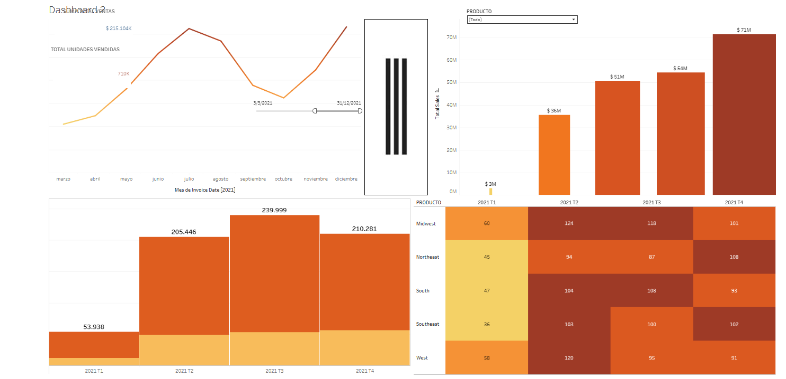
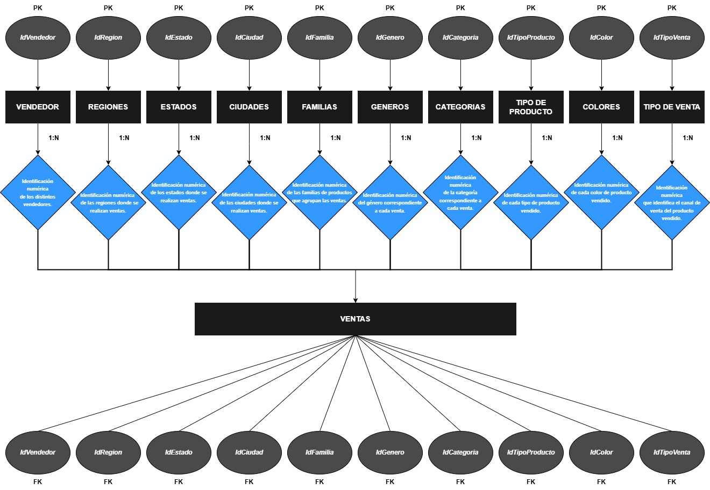

# Análisis de ventas de Adidas en EE. UU. (2020–2021)

Proyecto final del curso **Data Analytics & Business Intelligence** de Coderhouse. Analiza las ventas y la rentabilidad de Adidas en Estados Unidos por región, estado, ciudad, minorista, canal de venta y tipo de producto.

**[Ver el dashboard en Tableau Public](https://public.tableau.com/app/profile/gonzalo.matias.oderigo/viz/ADIDASSALES20202021/Dashboard2)**



## Objetivo

Obtener métricas de ventas, rentabilidad y desempeño de tiendas que sirvan para definir metas y tomar decisiones comerciales, pensando en equipos de ventas, marketing y administración de datos.

## Hipótesis

1. Las ventas online superaron a las ventas físicas durante 2020–2021, impulsadas por las restricciones de la pandemia.
2. Las tiendas de grandes ciudades generaron más ingresos que las de ciudades más chicas.
3. La rentabilidad tuvo picos en fechas clave como Black Friday, Navidad y el inicio del año escolar.

## Herramientas

- **SQL Server Management Studio**: normalización del dataset en un modelo relacional de 11 tablas.
- **Power BI**: transformación con Power Query, modelado y medidas DAX, dashboard principal.
- **Tableau Public**: versión complementaria del análisis.
- **Excel** y **draw.io**: exploración inicial de los CSV y diagrama del modelo.

## Modelo de datos

Una tabla de hechos (`VENTAS`) relacionada con diez dimensiones: vendedores, regiones, estados, ciudades, familias, géneros, categorías, tipos de producto, colores y tipos de venta.



## Proceso

**Transformación (Power Query)**
- Corrección de tipos de datos, traducción de categorías, regiones y tipos de producto al español.
- Conversión del porcentaje de rentabilidad a decimal y creación de columnas calculadas de facturación (unidades × precio unitario) y rentabilidad (facturación × porcentaje).
- Combinación con una tabla de escudos por estado para los tooltips del mapa.

**Medidas DAX destacadas**
- Tabla calendario con `CALENDARAUTO()`, columnas de año, trimestre y mes.
- Rentabilidad total, facturación y rentabilidad promedio, mediana y cuartiles con `PERCENTILE.INC`.
- Estado con más y menos ventas (moda) y estado más y menos rentable con `SUMMARIZE` y `TOPN`.
- Diferencia y tasa mensual con `DATEADD`, y un tacómetro que compara el mes seleccionado con el anterior.

**Visualizaciones**
- Mapa de rentabilidad por estado con tooltips personalizados.
- Matriz por año y trimestre con tasa y diferencia trimestral.
- Gráficos por categoría, producto, tipo de venta, región y vendedor.
- Navegación con botones, marcadores para limpiar filtros y una página de conclusiones.

El detalle completo de cada paso está en [`docs/documentacion-proyecto.pdf`](docs/documentacion-proyecto.pdf).

## Estructura del repositorio

```
adidas-sales-analisis/
├── dashboards/
│   ├── adidas-sales-powerbi.pbix     # Dashboard de Power BI
│   └── adidas-sales-tableau.twbx     # Libro de Tableau
├── data/
│   └── adidas-sales-dataset.csv      # Dataset original
├── docs/
│   └── documentacion-proyecto.pdf    # Documentación de la entrega final
└── img/                              # Capturas y diagrama del modelo
```

## Cómo verlo

- **Power BI**: abrí `dashboards/adidas-sales-powerbi.pbix` con [Power BI Desktop](https://powerbi.microsoft.com/desktop/) (gratuito).
- **Tableau**: abrí el link de Tableau Public de arriba, o el archivo `.twbx` con Tableau Public Desktop.

## Fuente de los datos

Dataset público [Adidas US Sales](https://data.world/stellabigail/adidas-us-sales-datasets), publicado en data.world. Se usa con fines educativos.

## Autor

**Gonzalo Matías Oderigo** · [LinkedIn](https://www.linkedin.com/in/gonzalo-matias-oderigo) · [GitHub](https://github.com/GonzOderigo)
